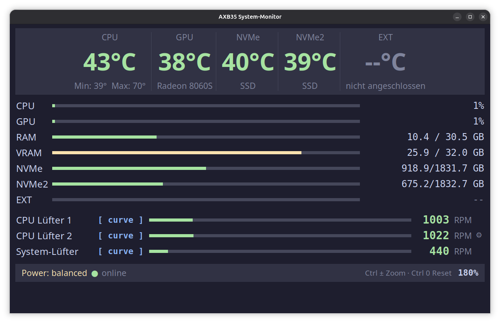
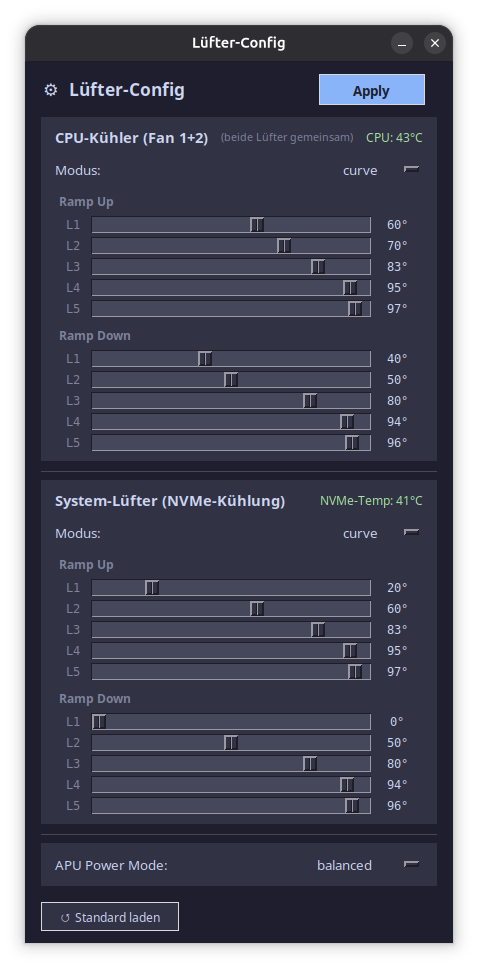

# ec-su_axb35-linux – Fan Control & System Monitor

Linux fan control and system monitoring for the **Sixunited AXB35-02** embedded controller board, found in AMD Strix Halo (Ryzen AI Max+) mini PCs.

**Compatible hardware:** GMKtec EVO-X2 · Bosgame M5 · FEVM FA-EX9 · Peladn YO1 · NIMO AI MiniPC · Corsair AI Workstation 300

> **Driver credits:** [Cmetz](https://github.com/cmetz) – original `ec-su_axb35-linux` kernel module · [eschaubert](https://github.com/eschaubert/ec-su_axb35-linux) – hwmon integration.
> This fork adds an all-in-one **system monitor + fan configuration GUI** and **boot persistence** on top of the base driver.

More info: [Strix Halo Homelab Wiki](https://strixhalo-homelab.d7.wtf/Hardware/Boards/Sixunited-AXB35) · [Power Mode & Fan Control Guide](https://strixhalo-homelab.d7.wtf/Guides/Power-Mode-and-Fan-Control)

---

## Installation

### Prerequisites
```bash
sudo apt install dkms openssl build-essential linux-headers-generic python3-tk smartmontools -y
```

### 1) Build & install the kernel module (DKMS)
```bash
cd contrib/ubuntu
sudo bash 02_install_ec_axb35_dkms.sh
```
This installs `dkms`, copies the source, builds + loads the module (`modprobe ec_su_axb35`), and registers it to rebuild automatically on every kernel update.

**Secure Boot:** If `mokutil --sb-state` reports *enabled*, set up MOK signing first (then enroll the key at the next boot):
```bash
sudo bash contrib/ubuntu/01_setup_dkms_mok.sh   # reboot → blue MOK screen → “Enroll MOK”
```
If Secure Boot is **disabled**, skip this step entirely.

### 2) Load the module automatically at every boot
Create `/etc/modules-load.d/ec_su_axb35.conf`:
```bash
echo "ec_su_axb35" | sudo tee /etc/modules-load.d/ec_su_axb35.conf
```
> The DKMS script above adds the module to `/etc/modules` instead – that is functionally equivalent. Either mechanism works; you only need one of them.

### 3) Verify
```bash
lsmod | grep ec_su_axb35          # module loaded?
ls /sys/class/ec_su_axb35/        # expected: fan1/ fan2/ fan3/ temp1/ apu/
cat /sys/class/ec_su_axb35/fan1/rpm
```

---

## Boot persistence (module + fan curves)

Two pieces are required for full control to survive a reboot:

| Concern | Handled by | Created by |
|---------|-----------|------------|
| Kernel module loads at boot | `/etc/modules-load.d/ec_su_axb35.conf` | you / the DKMS script (or `/etc/modules`) |
| Your fan curves + mode re-applied at boot | `/etc/systemd/system/fancontrol.service` | **Config Panel → Apply** (automatic) |

- The **fan control service is *not* part of the stock driver.** It is created and enabled automatically the first time you click **Apply** in the Config Panel. Until you do that, your custom curves will not persist across reboots – they fall back to the board's default EC behavior.
- At boot the service runs after the module is loaded and writes each fan's `rampup_curve`, `rampdown_curve` and `mode=curve`.

---

## System-Monitor + Fan Config GUI

A single-file Python/Tkinter app (standard library only) that combines **live system monitoring** and **fan configuration** in one window. Located in `python-gui/`.



```bash
# Quick test:
python3 ./python-gui/axb35_monitor_gui.py

# Install system-wide (optional):
sudo install -m 755 ./python-gui/axb35_monitor_gui.py /usr/local/bin/axb35-system-monitor
cp ./python-gui/axb35-monitor.desktop ~/.local/share/applications/
```

### Features
| Area | Details |
|------|---------|
| Temperatures | CPU · GPU (Radeon 8060S iGPU) · NVMe ×2 (internal) · external USB SSD |
| Usage bars | CPU % · GPU % · RAM · VRAM · disk space · ext. SSD usage |
| Fans | 3× RPM + mode badge (auto / fixed / curve) + activity bar |
| Config panel | ⚙️ button → per-fan mode, level 0–5, ramp-up/down curves, APU power mode |
| Persistence | **Apply** writes sysfs immediately + creates/enables `fancontrol.service` (survives reboot) |
| Zoom | Ctrl+= / Ctrl+- / Ctrl+0 (50 %–200 %); window scales; zoom & position persisted |
| Localization | DE/EN, auto-detected from the system locale |
| Theme | Catppuccin Mocha (dark), 1.5 s refresh |

> Temperatures are detected **dynamically by hwmon name** (`amdgpu`, `nvme` #1/#2), so the monitor stays correct even if sensor indices change across kernels or devices.

### Fan configuration



- **CPU cooler** (fan 1+2, controlled together): mode · level · ramp-up/down curves
- **System fan** (fan 3, NVMe cooling): same controls + live NVMe temperature as context
- **APU power mode**: quiet / balanced / performance
- **Load Standard**: resets to the recommended values below

| Fan | Ramp Up (°C) | Ramp Down (°C) |
|-----|-------------|----------------|
| CPU (fan 1+2) | 60, 70, 83, 95, 97 | 40, 50, 80, 94, 96 |
| System (fan 3) | 20, 60, 83, 95, 97 | 0, 50, 80, 94, 96 |

> **Apply** = takes effect immediately + persists to `/etc/systemd/system/fancontrol.service`. If the service doesn't exist yet, it is created and enabled automatically.

### Optional: passwordless sudo (comfort)
Without these rules everything still works – you just get a password prompt where noted.

```bash
# External USB SSD temperature (smartctl SMART reads):
echo "$USER ALL=(root) NOPASSWD: /usr/sbin/smartctl" | sudo tee /etc/sudoers.d/axb35-smartctl

# Config Panel “Apply” (write sysfs + manage the service):
echo "$USER ALL=(root) NOPASSWD: /bin/sh"           | sudo tee /etc/sudoers.d/axb35-fanconfig
```
> Both rules are scoped – they grant only `smartctl` and `/bin/sh` (used by the Apply helper), not general root.

---

## Sysfs Interface

### Fans (`/sys/class/ec_su_axb35/fan{1,2,3}/`)
| File | Access | Description |
|------|--------|-------------|
| `rpm` | RO | Current speed in RPM |
| `mode` | RW | `auto` · `fixed` · `curve` |
| `level` | RW | 0–5 – fan speed level (used with `fixed` mode) |
| `rampup_curve` | RW | 5 temperature thresholds in °C (heating) |
| `rampdown_curve` | RW | 5 temperature thresholds in °C (cooling) |

### Temperature (`/sys/class/ec_su_axb35/temp1/`)
| File | Access | Description |
|------|--------|-------------|
| `temp` | RO | Current CPU temperature (°C) |
| `min` | RO | Minimum since driver load |
| `max` | RO | Maximum since driver load |

### APU (`/sys/class/ec_su_axb35/apu/`)
| File | Access | Description |
|------|--------|-------------|
| `power_mode` | RW | `quiet` · `balanced` · `performance` |

---

## Contrib / Integrations
- `contrib/ubuntu/` – DKMS + MOK signing setup scripts
- `contrib/netdata/` – Netdata chart integration for fan/RPM monitoring

---

## Troubleshooting
| Issue | Solution |
|-------|----------|
| Monitor says “driver not found” | `lsmod \| grep ec_su_axb35`; if empty → `sudo modprobe ec_su_axb35` |
| Fans reset to default after reboot | Ensure module auto-load (step 2) **and** that you've clicked **Apply** at least once (creates `fancontrol.service`) |
| Secure Boot blocks the module | Enroll the MOK key (`01_setup_dkms_mok.sh`) or disable Secure Boot in UEFI |
| Kernel update breaks the driver | Only when installed manually without DKMS – with DKMS this won't happen |
| GUI prompts for a password (Apply / ext. SSD temp) | Add the scoped sudoers rules shown above (optional) |
| External SSD not detected | `smartctl -a /dev/sda`; check the device name on your system |

---

*Last updated: 20.10.2026*
